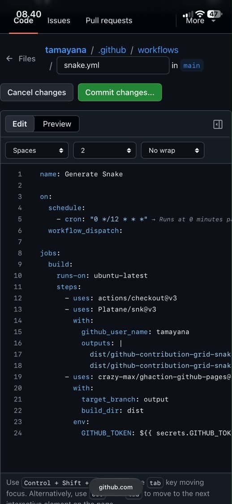

# I'm Mr.Tamaaa
### Pontianak | West Kalimantan | Explorer

> "What hackers do is explore technology and experiment with it in ways that many people have never even imagined. They also possess a strong desire to share this information with others—explaining it to people whose only qualification might be a genuine eagerness to learn. If you cannot find a path, create one yourself."
> — Mr.Tamaaa | Pontianak, West Kalimantan

---

### 🔗 CONNECT WITH ME

  
  

---

### 🛠️ TECH STACK I LEARNED

  

  

---

### 📊 GITHUB STATS

 

### 🐍 SNAKE EATING CONTRIBUTIONS

**Mr.Tamaaa | Pontianak**

